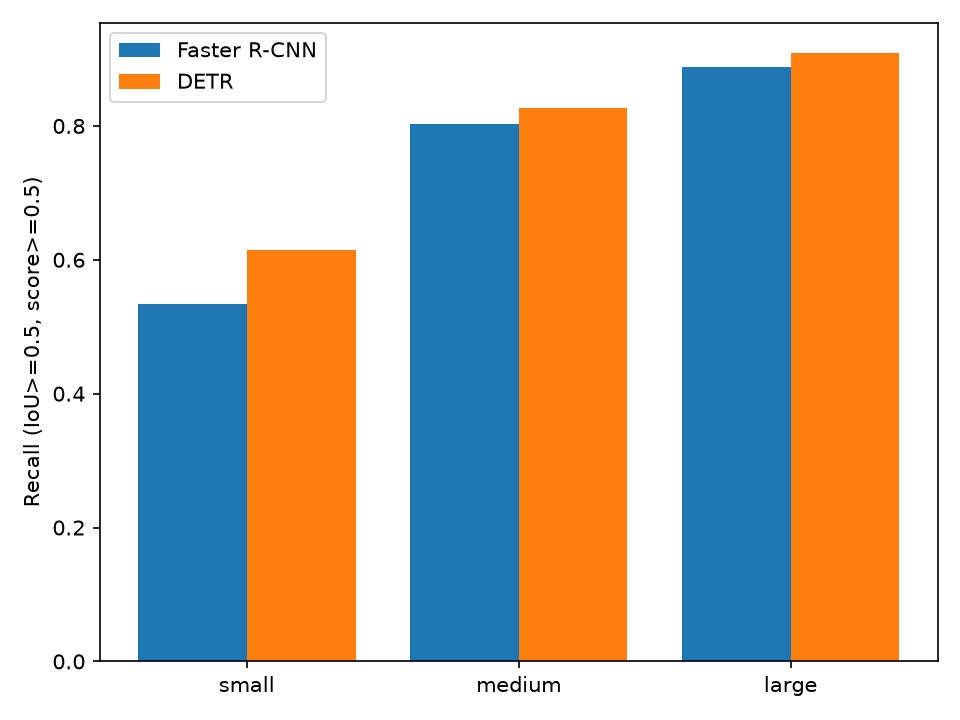
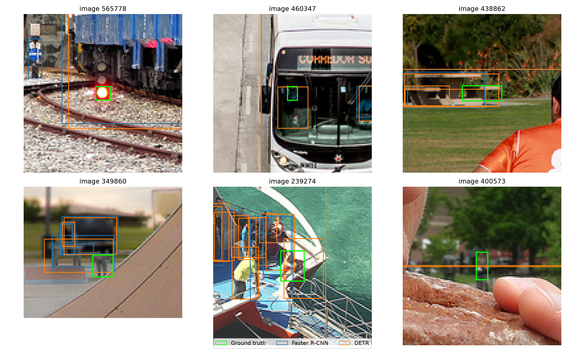

# DETR vs. Faster R-CNN on Small Objects

A small empirical check on 100 COCO val2017 images. In my survey on vision transformers in object detection I wrote that DETR has trouble with small objects. Here I tested that claim myself, on my own laptop.

Author: Sara Mohseni

Full write-up: DETR_vs_FasterRCNN_Small_Objects_Report.pdf

## Main result

Recall by object size (a ground-truth box counts as found if at least one detection with score >= 0.5 overlaps it with IoU >= 0.5; class labels are ignored):

| Object size | Ground-truth boxes | Faster R-CNN recall | DETR recall |
|---|---|---|---|
| small | 195 | 53.3% | 61.5% |
| medium | 213 | 80.3% | 82.6% |
| large | 242 | 88.8% | 90.9% |

On this sample DETR found more small objects than Faster R-CNN, so the claim from my survey was not supported here. This is a recall at one threshold on 100 images, not AP, and I did not measure precision, so please read it as a sanity check and not as a verdict.

| | Faster R-CNN | DETR |
|---|---|---|
| Parameters | 41.8 M | 41.5 M |
| Mean CPU time per image | 24.58 s | 12.95 s |

Timings come from a single run on a laptop CPU. The Faster R-CNN time covers model inference only and the DETR time also includes pre- and post-processing, so the gap is only rough.

## What I did

- Data: the first 100 images of COCO val2017 (not a random sample), 650 ground-truth boxes after removing crowd annotations.
- Models: torchvision Faster R-CNN (ResNet-50-FPN) and facebook/detr-resnet-50 (Hugging Face Transformers). Both are pretrained and were used without fine-tuning, on CPU.
- Object size: from bounding-box area. Small < 32^2 px, medium < 96^2 px, large otherwise.

## Files

- analysis.ipynb: the code
- frcnn_results.json, detr_results.json: saved detections and timings
- recall_by_size.png, missed_small_examples.png: figures
- DETR_vs_FasterRCNN_Small_Objects_Report.pdf: short technical report

## How to reproduce

1. Install the packages: pip install torch torchvision transformers timm pillow matplotlib
2. Download the COCO 2017 annotations and the val2017 images from https://cocodataset.org . Put instances_val2017.json and the first 100 images (in a folder called images) next to the notebook. The data is not included in this repository.
3. Open analysis.ipynb. The cells that run the models take roughly 40 minutes (Faster R-CNN) and 20 minutes (DETR) on a laptop CPU. Their output is already saved in the two JSON files, so you can skip them and run the analysis cells.

## Limitations

- Only 100 images, and they are the first ones in the file, not a random sample.
- Class-agnostic recall at a single score threshold. No AP and no precision.
- Size comes from box area, not mask area.
- Pretrained models, no fine-tuning. The "slow convergence" point from my survey is not tested here.
- Timing is from one run on one laptop CPU.
